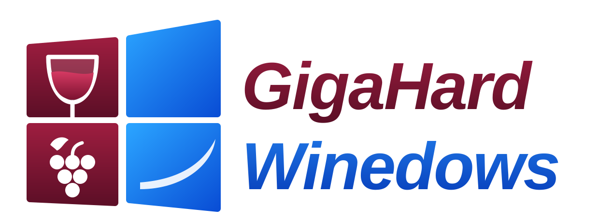

<p align="center"></p>

# GigaHard Winedows

> Linux, but it works.

A Debian 13 live ISO containing exactly three things: Cinnamon (dressed as a W*ndows desktop), Firefox, and Wine.
Double-click any `.exe` on the desktop and it runs. `apt` has been removed, so don't even try.

```
make iso    # needs Docker with --privileged; output in out/
make vm     # boot it in QEMU
make test   # headless smoke test
```

How it is built, the project rules and every decision so far: [docs/wiki](docs/wiki/) (start with [architecture](docs/wiki/architecture.md) and the rules in [joke-design](docs/wiki/joke-design.md#rules-hard)).

Login is automatic (user `user`, password `live`). Not affiliated with, endorsed by, or in any way competing with a certain company in Redmond.
